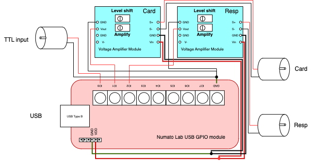
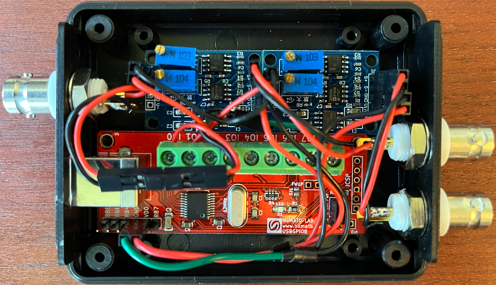

# Physiological Signal and TTL Recording

RTPSpy can record the cardiac and respiration signals and the scanner's TTL pulses during a scan. They are used for two things:

- **RETROICOR noise correction.** The REGRESS module removes cardiac and respiratory noise from each volume using the signals recorded up to that volume ('Physio (RICOR)' option).
- **The scan start.** The processing starts with the first TTL pulse from the scanner, and the TTL pulses tell RTPSpy when each volume was acquired (used for the RETROICOR regressors and the [latency](./README.md#processing-latency) report).

**The devices are optional.** Without them, RTPSpy works without RETROICOR, and you start the scan with the 'T' key or the 'Manual start' button (see [README](./README.md#starting-the-scan-ttl-trigger-or-the-t-key)).

## Contents

- [How the recording works](#how-the-recording-works)
- [Supported devices](#supported-devices)
- [Without a device](#without-a-device)
- [Checking the signals](#checking-the-signals)
- [Building the Numato input for BIOPAC amplifiers](#building-the-numato-input-for-biopac-amplifiers)
- [GE scanner physio output](#ge-scanner-physio-output)

## How the recording works

When an RTPSpy application starts, it starts a helper program, **rt_physio** (`rtpspy/rt_physio.py`), in the background. rt_physio:

- looks for a recording device, in this order: Numato USB GPIO, GE serial port;
- records the signals continuously into a buffer (the last hour), which RTPSpy reads in real time;
- shows the signals in the **physio window**. The 'Physio' check box in the RTPSpy window shows or hides it; its close button only hides it, and the recording goes on;
- saves the signals of each scan at the scan end, as `<scan>_physio.tsv.gz` with a JSON file in the `log` folder of the working directory (BIDS format: columns `cardiac`, `respiratory`, and `trigger`).

In your own code, the `RtpTTLPhysio` class (`rtpspy/rtp_ttl_physio.py`) is the interface to rt_physio. Its `get_retrots()` method returns the RETROICOR regressors.

## Supported devices

| Device | Signals | Notes |
|---|---|---|
| [Numato 8 Channel USB GPIO Module](https://numato.com/product/8-channel-usb-gpio-module-with-analog-inputs/) | TTL, cardiac, respiration | TTL on **IO0** (digital input), cardiac on **IO1/ADC1**, respiration on **IO2/ADC2** (analog inputs, 0-5 V, 10 bits). Sampled at 100 Hz by default. |
| GE scanner physio output (serial port) | Cardiac, respiration | From the scanner's pulse oximeter and respiration belt, at 100 Hz. The TTL still comes from the Numato module. |
| Dummy (simulation) | Simulated | Plays recorded signals from files in a loop. Used by the [RT-MRI simulator](./Simulator.md). |

The TTL input of the Numato module is read about every millisecond, so a TTL pulse should be at least a few milliseconds long. If your scanner's pulses are shorter, use a pulse generator to stretch them (we stretch them to 10 ms).

Both devices are USB serial devices. On Linux, your user must be in the `dialout` group to use them:

```bash
sudo usermod -a -G dialout $USER
```

Log out and in again (or reboot) after this.

## Without a device

If no device is found when RTPSpy starts:

- the physio window is not shown, and the 'Physio' check box is disabled;
- the 'Physio (RICOR)' option of REGRESS is disabled and set to 'None';
- start the scan with the 'T' key (with the RTPSpy window active) or the 'Manual start' button.

If a device becomes available later (e.g., the simulator starts feeding signals), the physio window appears, the controls are enabled again, and 'Physio (RICOR)' is set back to its previous value. These changes wait until the current run ends.

## Checking the signals

Before a session, check that the signals look right in the physio window: the respiration trace shows regular waves (not flat, and not cut off at the top or bottom), and the cardiac trace shows regular pulses. The TTL pulses appear while the scanner is running.

To check the signals without starting an RTPSpy application, run rt_physio by itself:

```bash
~/RTPSpy/.venv/bin/python ~/RTPSpy/rtpspy/rt_physio.py
```

Useful options: `--device Numato|GE|Dummy` (instead of the automatic selection), `--sample_freq` (the Numato sampling rate in Hz, default 100), and `--debug` (log messages in the terminal).

## Building the Numato input for BIOPAC amplifiers

With a BIOPAC system, the cardiac signal can be recorded with the [Photoplethysmograph Transducer for MRI (TSD200-MRI)](https://www.biopac.com/product/photoplethysmograph-transducer-for-mri/), the [Photo Plethysmogram Amplifier for MRI](https://www.biopac.com/product/pulse-plethysmogram-amplifier-for-mri/), and the [MRI Filtered Cable Sets](https://www.biopac.com/product/mri-filtered-cable-sets/). The respiration signal can be recorded with the [Respiration Transducer for MRI (TSD221-MRI)](https://www.biopac.com/product/respiration-transducer-for-mri/) and the [General Purpose Transducer Amplifier](https://www.biopac.com/product/general-purpose-transducer-amplifier/). The [Amplifier Input Module](https://www.biopac.com/product/input-module/) outputs both as analog signals.

These analog outputs cannot go to the Numato module directly: they include negative voltages and can be small, while the Numato analog inputs read 0-5 V with 10-bit resolution ([Numato documentation](https://numato.com/docs/8-channel-usb-gpio-module-with-analog-inputs/#gpio-analog-inputs-9)). The signals must be shifted and amplified first. We use a [voltage amplifier module](https://www.amazon.com/dp/B08QM9SM1W) for each signal. The circuit diagram and a picture of our input device:




To adjust the amplifiers, run rt_physio by itself (see [Checking the signals](#checking-the-signals)) and turn the screws on the amplifier modules while watching the signals: the upper screw shifts the level, and the lower screw sets the amplification. Fit the signals within the plot range without clipping.

## GE scanner physio output

GE scanners can send the cardiac (pulse oximeter) and respiration (belt) signals through a serial port of the scanner's backend computer. rt_physio decodes these data in real time. Consult GE for how to enable this output and connect the port to the RTPSpy computer.
