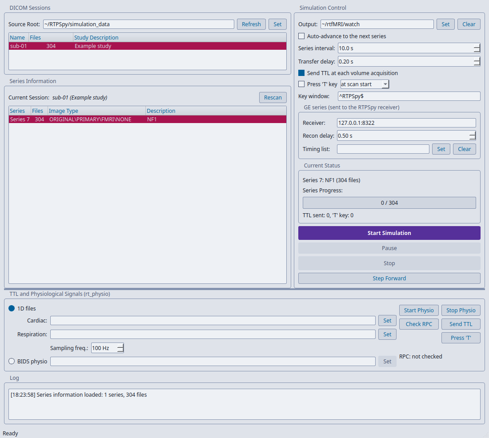

# RT-MRI Simulator

The RT-MRI simulator replays a recorded scan session as if the scanner were running, so that you can test an RTPSpy application on any computer, without the scanner:

- **Images**: the files of a recorded session are delivered to RTPSpy at the times they were made on the scanner. Siemens files are copied into the watch directory; GE files are sent to the GE receiver of RTPSpy, as the console sender does.
- **Scan trigger**: a TTL pulse at the acquisition of each volume (to rt_physio), and/or the 'T' key.
- **Physiological signals**: recorded cardiac and respiration signals are played to rt_physio.



## Contents

1. [Start the simulator](#1-start-the-simulator)
2. [Choose a session and a series](#2-choose-a-session-and-a-series)
3. [Deliver the images](#3-deliver-the-images)
4. [Scan trigger: TTL and the 'T' key](#4-scan-trigger-ttl-and-the-t-key)
5. [Physiological signals](#5-physiological-signals)
6. [A typical test](#6-a-typical-test)
7. [How the timing is reproduced](#7-how-the-timing-is-reproduced)
8. [Settings, cache, and options](#8-settings-cache-and-options)
9. [Troubleshooting](#9-troubleshooting)

## 1. Start the simulator

```bash
~/RTPSpy/boot_rtmri_simulator.sh
```

The simulator runs in the RTPSpy environment made by `install.sh`. Start your RTPSpy application too (on the same computer, or see `--physio_host` in [section 8](#8-settings-cache-and-options)).

## 2. Choose a session and a series

**Source Root** (top left) is the folder that holds your recorded sessions; the default is `~/RTPSpy/simulation_data`. Press 'Set' to choose another folder, and 'Refresh' to search it again. The sessions found are listed:

- **Siemens**: a folder of DICOM files (`*.dcm`), directly or in a `dicom` subfolder, or with series subfolders (`S001`, `Ser001`, ...).
- **GE**: an exam folder of the console's image pool, `p<N>/e<N>`, with series folders `s<N>` of slice files `i*.MRDC.*`. Copy the exam folder from the console as it is.

Select a session. The simulator reads the headers of all its files (this takes a while the first time) and lists its series. Select the series to start from.

- **Rescan** reads the headers again (e.g., after adding files).
- Siemens phase series (`..._Pha`) are shown in gray: they are sent together with their magnitude series.

## 3. Deliver the images

### Siemens series: copied into the watch directory

Set **Output** (top right) to the **watch directory** of your RTPSpy application. Each file is copied there at the time it was made on the scanner, plus **Transfer delay** (the time to transfer a file to the export folder; 0.2 s by default).

'Clear' deletes everything in the output folder (after a confirmation).

### GE series: sent to the GE receiver of RTPSpy

In RTPSpy, turn on the GE receiver: 'RTP' → 'WATCH' → **GE receiver port** (e.g., `8322`), and leave 'GE console IP' empty or add `127.0.0.1` for a simulator on the same computer. See [GE setup](GESetup.md#2-set-up-rtpspy-to-receive-the-images).

In the simulator, under **GE series**:

| Setting | Meaning |
|---|---|
| Receiver | `host:port` of the GE receiver, e.g., `127.0.0.1:8322` |
| Recon delay | Time from the end of a volume's acquisition to the writing of its first slice on the console (default 0.5 s) |
| Timing list | Optional: a listing of the file times recorded on the console, to replay the real order and delays (see [section 7](#7-how-the-timing-is-reproduced)) |

The slice files are sent with their names in the image pool (`p*/e*/s*/i*.MRDC.*`); RTPSpy writes them into its watch directory and puts the slices of each volume together. The simulator decides from the files whether a series is GE; the Output folder is not used for GE.

### Controls

| Button | Action |
|---|---|
| Start Simulation | Start the selected series from its first file (or from where it was paused). |
| Pause / Resume | Stop after the current file / continue from there. |
| Stop | Stop and go back to the start of the series. |
| Step Forward | Deliver only the next file, at once (with the TTLs due before it). |

- **Auto-advance to the next series**: after a series, wait **Series interval** seconds and start the next one, as in a scan session.
- The progress bar shows the files of the series delivered; the log lists each file.

## 4. Scan trigger: TTL and the 'T' key

RTPSpy starts processing at the scan start: with a TTL pulse, the 'T' key, or 'Manual start' (see the [README](README.md#starting-the-scan-ttl-trigger-or-the-t-key)). The simulator can produce either signal.

- **Send TTL at each volume acquisition**: a TTL pulse is sent to rt_physio (the physio recording program that RTPSpy starts) at the acquisition time of each volume. The planned time is sent with the pulse, so delays of the communication do not change the recorded time.
  > rt_physio records these pulses only while it plays the simulated physio signals. Press **Start Physio** first ([section 5](#5-physiological-signals)).
- **Press 'T' key**: the simulator presses the `t` key at the scan start ('at scan start') or at every volume ('at every volume'), as a trigger box that sends key presses does. The key is sent to the window whose title matches **Key window** (a regular expression; the default `^RTPSpy$` is the RTPSpy main window), which is brought to the front first. Leave 'Key window' empty to send the key to the window that has the focus.
  This needs `xdotool` (`sudo apt install xdotool`); the setting is disabled without it.
- **Send TTL** and **Press 'T'** (bottom right) send one TTL pulse or one 'T' key at once.

The counts of the TTL pulses and 'T' keys sent are shown under 'Current Status'.

## 5. Physiological signals

The simulator feeds rt_physio's simulated recording device ("Dummy") with recorded signals. rt_physio plays them in a loop, and its physio window appears. (Without a recording device, RTPSpy hides the physio window and turns off the physio regressors; they come back when the simulated signals start.)

Choose the signals:

- **1D files**: two text files with one value per line, **Cardiac** and **Respiration**, and their **Sampling freq.**
- **BIDS physio**: a `*_physio.tsv` or `*_physio.tsv.gz` file with its JSON sidecar (`*_physio.json`), which must have `SamplingFrequency`, `StartTime`, and `Columns` including `cardiac` and/or `respiratory`. The physio files saved by RTPSpy can be used as they are.

| Button | Action |
|---|---|
| Start Physio | Start playing the signals (rt_physio must be running, i.e., an RTPSpy application). |
| Stop Physio | Stop the simulated device. |
| Check RPC | Check that rt_physio responds; the result is shown below the buttons. |

## 6. A typical test

1. Start your RTPSpy application. Set its watch and working directories, make the masks, and set up the processing (see the [ROI-NF example](example/ROI-NF#readme)).
2. Start the simulator. Set **Output** to RTPSpy's watch directory (Siemens), or turn on the GE receiver in RTPSpy and set **Receiver** (GE).
3. For physio and TTL: choose the signals and press **Start Physio**; keep 'Send TTL at each volume acquisition' checked. Without them: check **Press 'T' key** ('at scan start').
4. Select the session and the fMRI series.
5. Press **Ready** in RTPSpy, then **Start Simulation** in the simulator.
6. RTPSpy starts with the first TTL (or the 'T' key) and processes each volume as it arrives. Check 'Latency' in RTPSpy to see the delays.

## 7. How the timing is reproduced

**Siemens.** The images are delivered with the delays of the scanner:

- a TTL pulse is sent at the acquisition time of each volume (`AcquisitionDateTime` or `AcquisitionTime`);
- each file is delivered at the time the image was made (`ContentTime`) plus 'Transfer delay'.

So the first image comes about one TR plus the reconstruction time after the first TTL, as on the scanner. (Sessions read by an older version of the simulator have no acquisition times in their cache: a TTL is then sent one TR before each volume's first file. 'Rescan' the session to use the acquisition times.)

**GE.** The GE DICOM files have no time at which each image was made, so the timing is planned:

- a TTL pulse at the start of each volume, (k − 1) × TR for volume k;
- without a timing list: the slices of volume k are sent after its acquisition (k × TR) plus 'Recon delay', one slice every 7 ms (about the speed at which a console writes them);
- with a **timing list**: the files are sent in the recorded order, with the recorded intervals, starting TR + 'Recon delay' after the first TTL. This reproduces, e.g., multiband reconstruction that falls behind the scan, and volumes completed out of order. Make the list on the console (tcsh), for an exam `p<N>`:

  ```text
  cd /export/home1/sdc_image_pool/images
  find p<N> -type f -name 'i*.MRDC.*' -printf '%T@ %s %p\n' | sort -n > ~/image_times.txt
  ```

  Each line is `<modification time> <size> <path>`. If some files of a series are not in the list, the planned timing is used for that series.

'Transfer delay' is added to the delivery times of both.

## 8. Settings, cache, and options

- **Settings** are saved when the simulator closes and restored at the next start: `~/.RTPSpy/rtmri_simulator_qt_config.json`.
- **Header cache**: the headers of a session are read once and saved in the session folder as `.rtmri_series_cache.csv`. Delete it or press 'Rescan' to read them again. The file paths in it are relative to the session folder, so a session can be moved or copied to another computer with its cache (a cache made by an older version, with absolute paths, is read from where the session is now and saved again with relative paths).
- **Command-line options** (`boot_rtmri_simulator.sh --help`):

  | Option | Meaning |
  |---|---|
  | `--physio_host HOST` | Host of rt_physio (default `localhost`), for an RTPSpy application on another computer |
  | `--rpc_config FILE` | The file in which rt_physio records its port (default `~/.RTPSpy/rtmri_config.json`, as RTPSpy uses) |
  | `--debug` | Show debug messages in the terminal |

## 9. Troubleshooting

| Problem | Check |
|---|---|
| No session is listed | 'Source Root' points to the folder that holds the sessions (up to three levels deep). Siemens files must end with `.dcm`; GE exams must keep the `p*/e*/s*` folders. |
| RTPSpy does not process the copied files (Siemens) | 'Output' is RTPSpy's watch directory, and 'Ready' was pressed in RTPSpy before the start. |
| "Cannot connect to the GE receiver" | RTPSpy is running with WATCH 'GE receiver port' set, and 'Receiver' has the same port. If 'GE console IP' is set in RTPSpy, it must include the simulator's address (`127.0.0.1` on the same computer). |
| No TTL is recorded | Press 'Start Physio' first; rt_physio records the simulated TTL only while it plays the simulated signals. 'Check RPC' must succeed. |
| The 'T' key does not reach RTPSpy | `xdotool` is installed; 'Key window' matches the title of the RTPSpy window (default `^RTPSpy$`). |
| "rt_physio does not respond" | An RTPSpy application must be running (it starts rt_physio). For an application on another computer, use `--physio_host`. |
