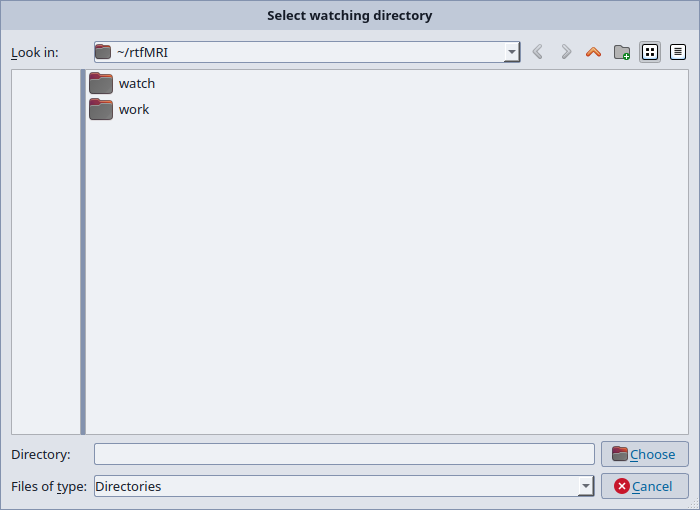
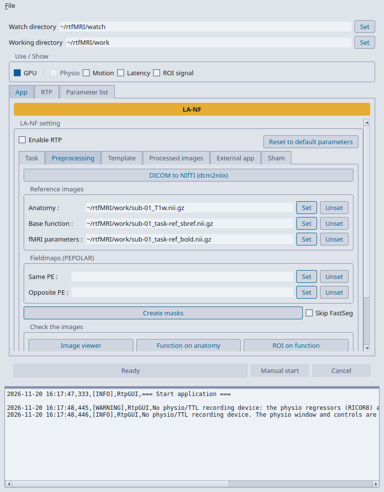
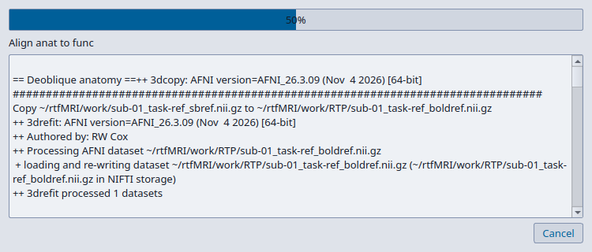
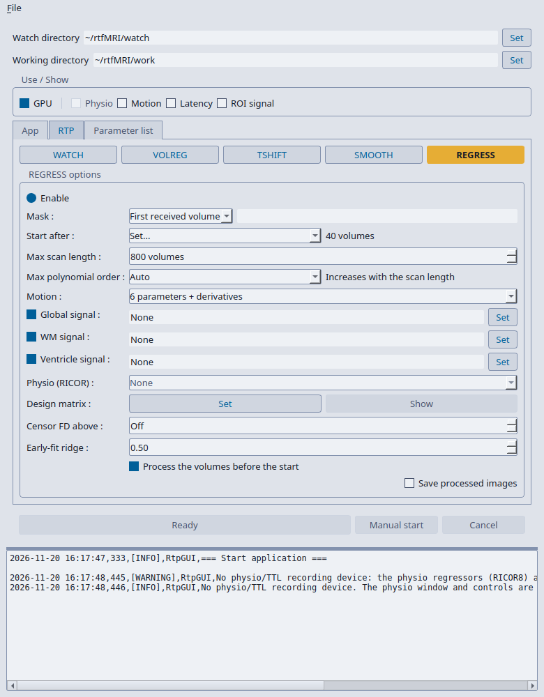
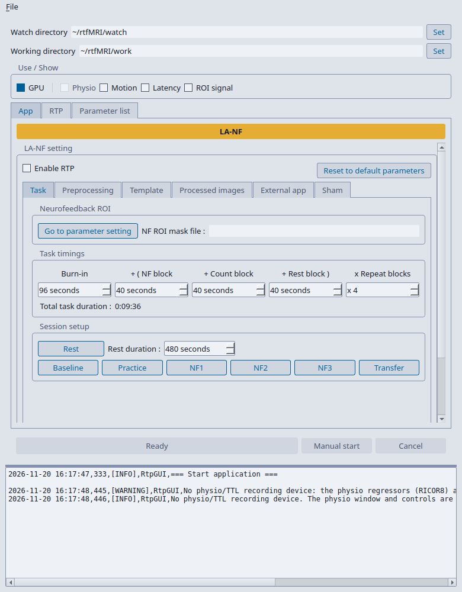
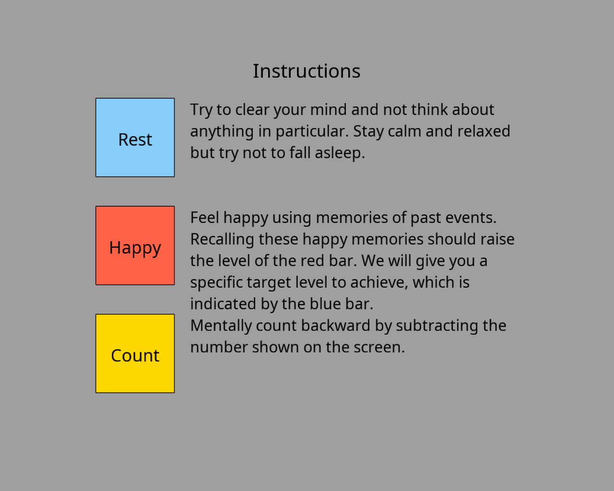
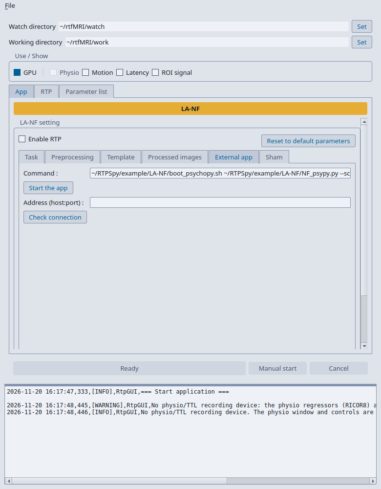
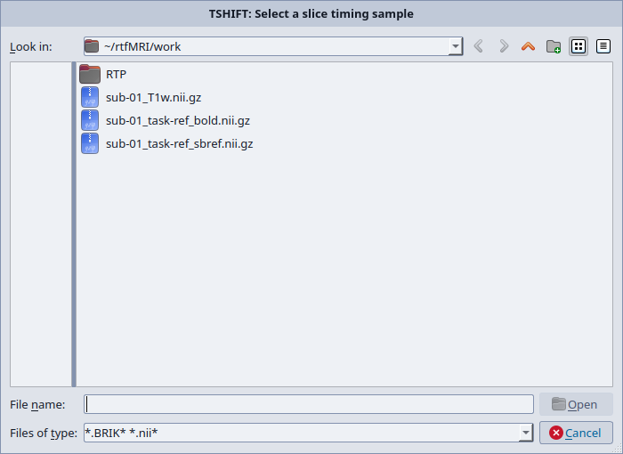
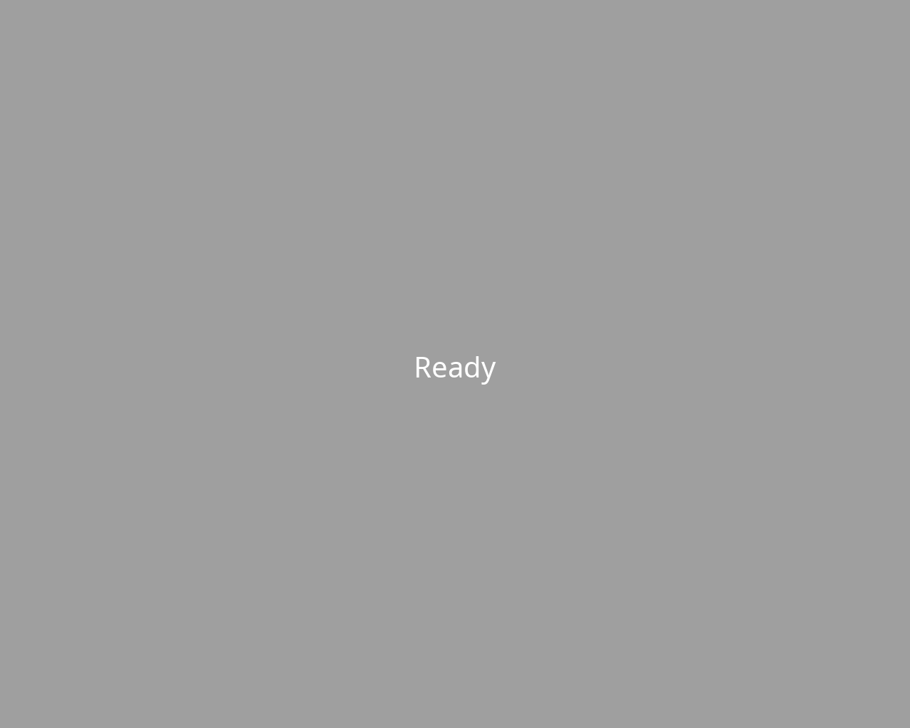
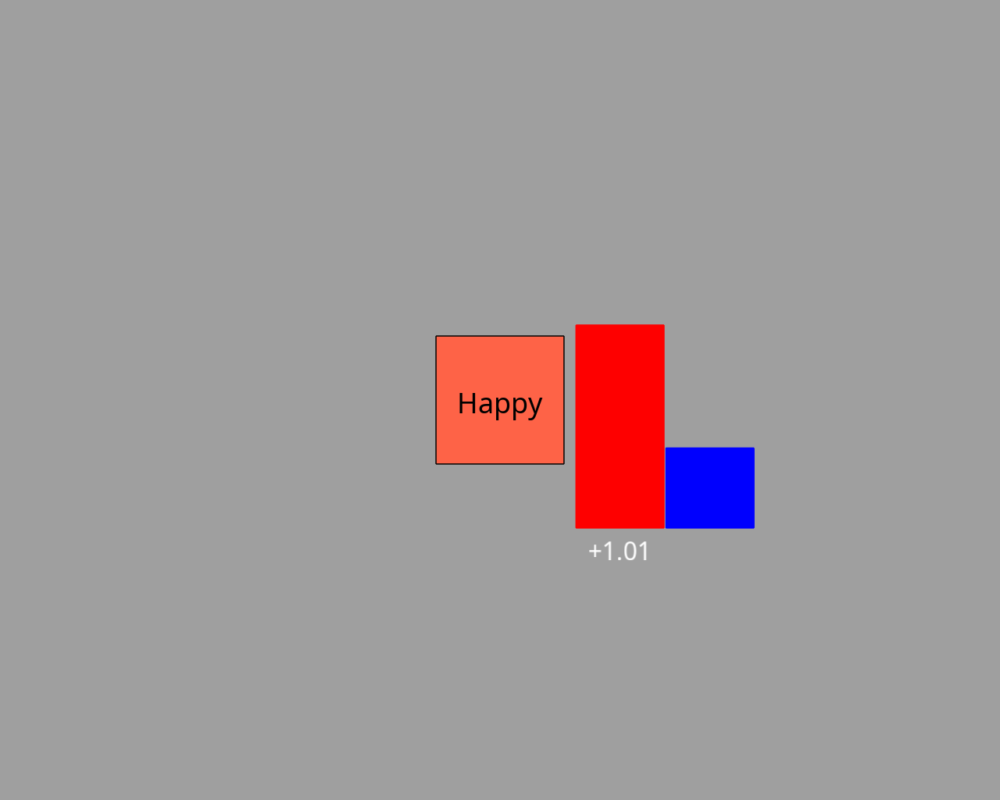

# LA-NF: Left Amygdala Neurofeedback Example

LA-NF is a complete RTPSpy application for a left amygdala (LA) neurofeedback session with happy autobiographical memory recall (Zotev et al., 2011; Young et al., 2017). It extracts the mean signal of the left amygdala from each fMRI volume in real time and sends it to a PsychoPy application, which presents the task blocks and the feedback.

This application is a demonstration. It was not used in the studies cited above, and several parameters differ from those reports. For a simpler template to build your own application, see the [ROI-NF example](../ROI-NF#readme).

- Young K.D. et al. (2017). Randomized Clinical Trial of Real-Time fMRI Amygdala Neurofeedback for Major Depressive Disorder: Effects on Symptoms and Autobiographical Memory Recall. Am J Psychiatry 174, 748-755.
- Zotev V. et al. (2011). Self-Regulation of Amygdala Activation Using Real-Time fMRI Neurofeedback. PLoS ONE 6, e24522.

Before you start, install RTPSpy with `install.sh` (see the [README](../../README.md#installation)). On macOS, the GUI layout may be slightly broken.

## 1. Start the application

```bash
cd ~/RTPSpy/example/LA-NF
./boot_LANF_RTPSpy.sh
```

Two dialogs ask for the **watch directory** (where the scanner exports the images during the scan) and the **working directory** (where RTPSpy saves its results). If you cancel a dialog, the previous setting is kept. You can change them later at the top of the window.



The LA-NF window opens.


The application saves its settings when it exits, in `RTPSpy_params.pkl` in the folder where you started it, and loads them at the next start. To start from the default settings, press 'Reset to default parameters' (the folders are not reset), or delete the file.

## 2. Make the masks

Scan an anatomical image and a reference functional image, and convert them to NIfTI ('DICOM to NIfTI (dcm2niix)' on the 'Preprocessing' tab). Then:

1. Press 'Go to parameter setting' (or open the 'Preprocessing' tab) and set the **Anatomy** and **Base function** images with the 'Set' buttons.
2. Press **'Create masks'**. A dialog shows the progress. When it finishes, the results are set as the masks for the real-time processing.





> [!NOTE]
> FastSeg (part of FastSurfer) segments the white matter and ventricles, and needs a GPU. Without one, 'Skip FastSeg' is checked, and AFNI's 3dSkullStrip and the template masks are used instead.

Check the result with the buttons in the 'Check the images' box (see the [ROI-NF guide](../ROI-NF#5-create-the-masks) for the image viewer).

## 3. Set the processing parameters (optional)

The processing parameters are in the 'RTP' panel. Press a module button to see and change its parameters.



## 4. Set up a run

Press 'Go to Task' at the bottom of the 'Preprocessing' tab, or open the 'Task' tab.



Press a button in the 'Session setup' box for the run you are about to scan: 'Rest', 'Baseline' (without feedback), 'Practice', 'NF1' to 'NF3' (neurofeedback training), or 'Transfer'. This starts the PsychoPy application if it is not running, and sets up the processing for the run. The PsychoPy window shows the task instructions.



- **PsychoPy window.** Its screen, size, and position are set in the 'Command' field of the 'External app' tab. Add `--fullscr` for full screen.
- **Slice timing.** At the first run, a dialog 'TSHIFT: Select a slice timing sample' may ask for a functional image with the slice timing information. Select one of the functional images of this session.





## 5. Get ready

Press **'Ready'**. The PsychoPy window shows 'Ready', and RTPSpy waits for the scan to start.



## 6. Start the scan

Start the fMRI scan. The processing and the PsychoPy task start with one of:

- the **scanner's TTL pulse**, if a TTL recording device is connected (see [Physiological signal and TTL recording](../../PhysioRecording.md));
- the **'T' key**, pressed while the RTPSpy window is active (a trigger box that sends the 't' key also works);
- the **'Manual start'** button.

The noise regression starts after enough volumes have arrived ('RTP' → 'REGRESS' → 'Start after'). The PsychoPy window shows the task blocks, and the neurofeedback signal during the happy memory blocks.



To test the application without a scanner, use the RT-MRI simulator (see the [RT-MRI Simulator guide](../../Simulator.md)).
