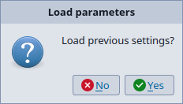
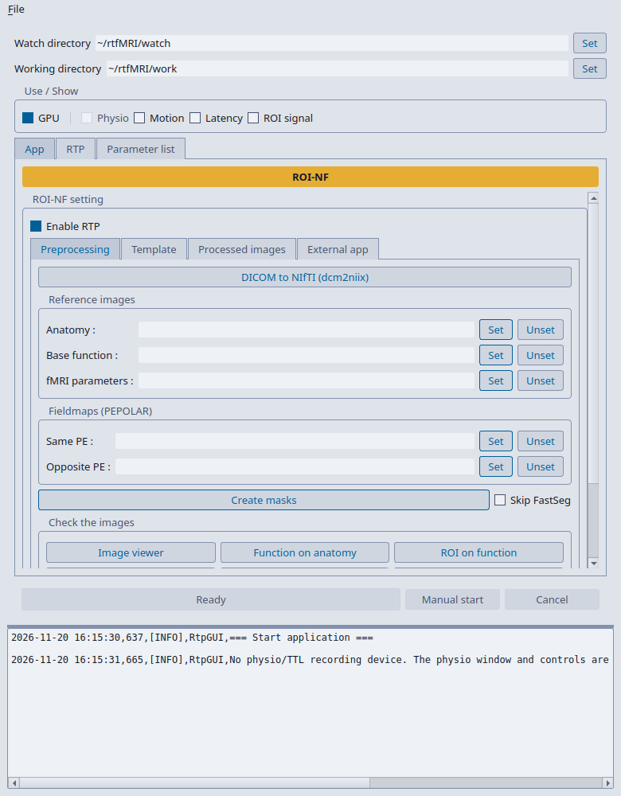
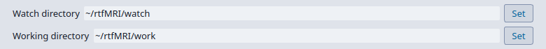
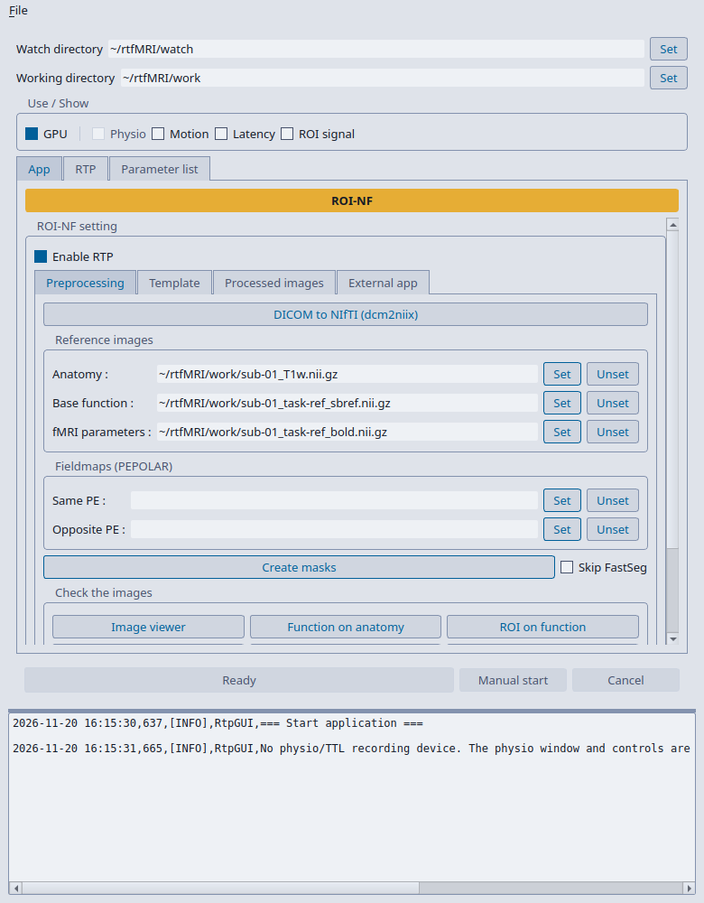
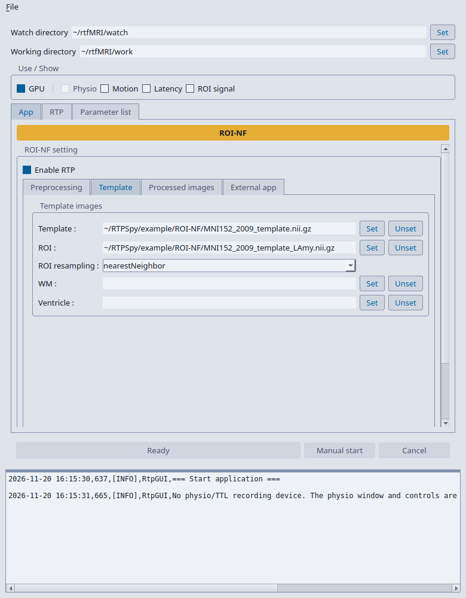
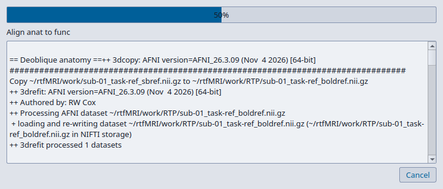
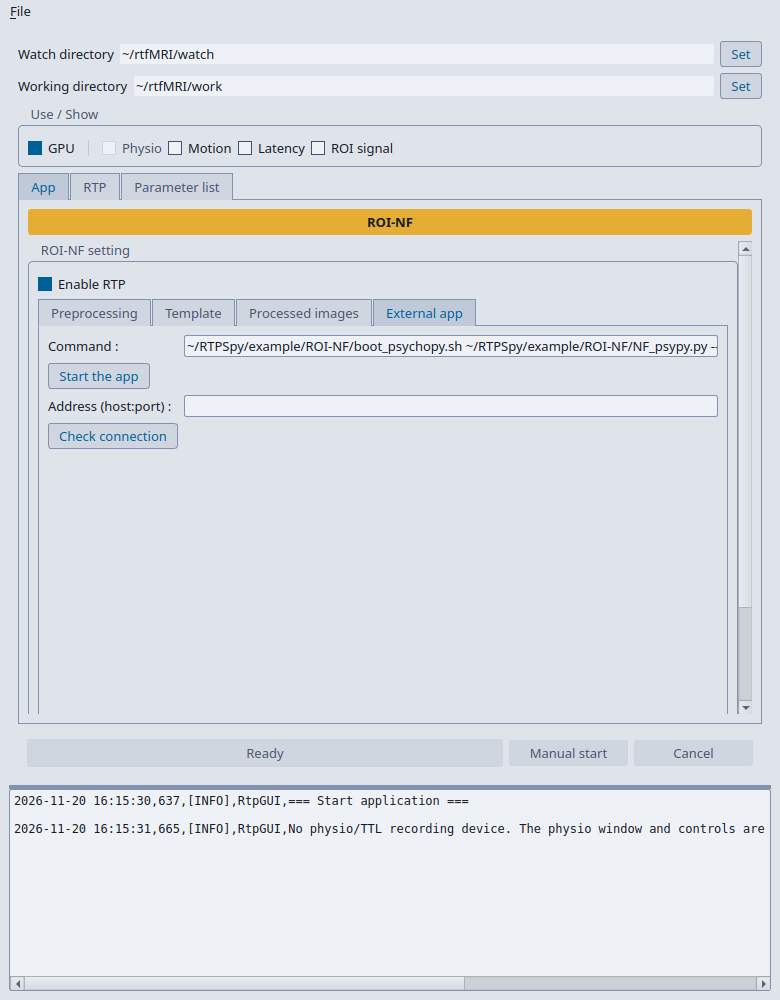
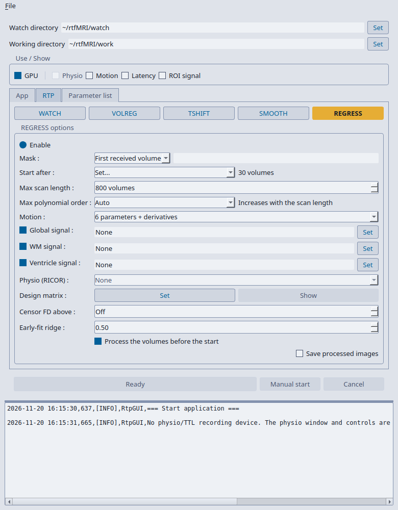
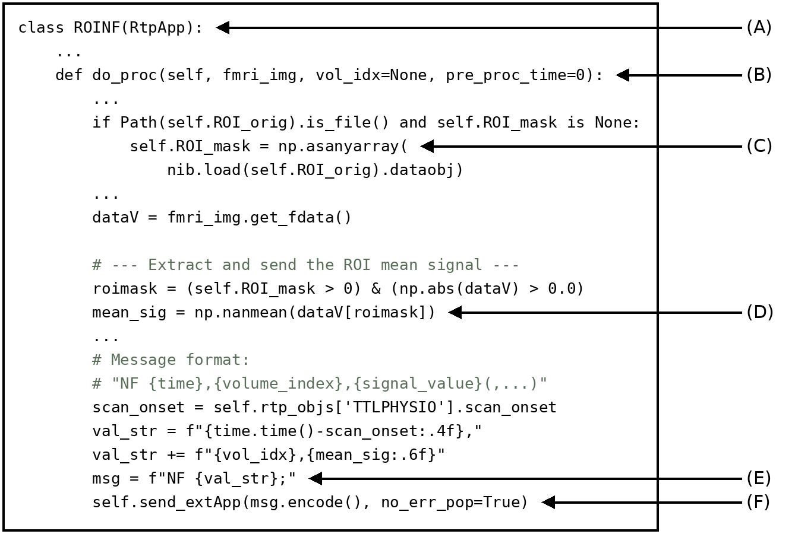
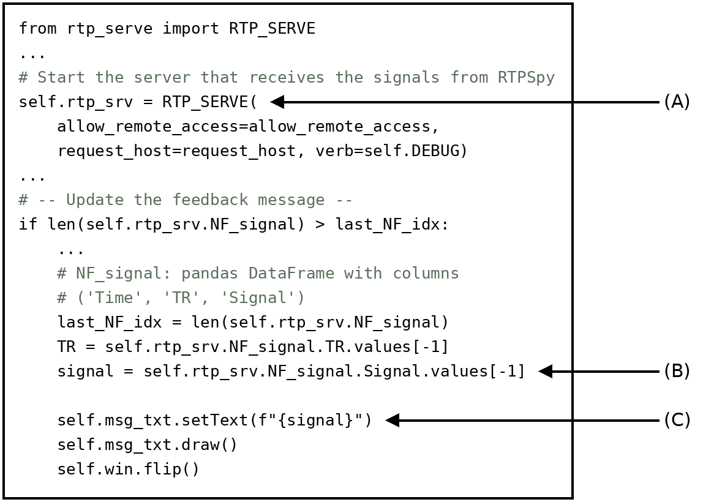

# ROI-NF: Example RTPSpy Application

ROI-NF extracts the mean signal of a region of interest (ROI) from each fMRI volume in real time and sends it to an external application. The example external application, a PsychoPy script (`NF_psypy.py`), simply shows the received values on the screen.

Use it as a template for your own neurofeedback application: the [last section](#customizing-the-application) shows which parts to edit.

Before you start, install RTPSpy with `install.sh` (see the [README](../../README.md#installation)).

## Contents

1. [Start the application](#1-start-the-application)
2. [Set the folders](#2-set-the-folders)
3. [Scan and convert the reference images](#3-scan-and-convert-the-reference-images)
4. [Set the reference and template images](#4-set-the-reference-and-template-images)
5. [Create the masks](#5-create-the-masks)
6. [Start the feedback application](#6-start-the-feedback-application)
7. [Set up the real-time processing](#7-set-up-the-real-time-processing)
8. [Get ready and start the scan](#8-get-ready-and-start-the-scan)

- [Testing without a scanner](#testing-without-a-scanner)
- [Customizing the application](#customizing-the-application)

## 1. Start the application

```bash
cd ~/RTPSpy/example/ROI-NF
./boot_ROINF_RTPSpy.sh
```

First, the application asks 'Load previous settings?'. Answer 'Yes' to continue with the settings of the last session, which the application saves when it exits (in `RTPSpy_ROINF_params.pkl`, in the folder where you started it).



Then the ROI-NF window opens.



## 2. Set the folders

Set the two folders at the top of the window:

- **Watch directory**: where the scanner exports the fMRI images (e.g., DICOM files) during the scan. To test without a scanner, this is where the [simulator](#testing-without-a-scanner) copies the images.
- **Working directory**: where RTPSpy saves the converted and processed images and the logs.



## 3. Scan and convert the reference images

Scan the images needed to make the masks:

- an **anatomical image** (e.g., T1-weighted);
- a **reference functional image** for position (e.g., an SBRef image);
- a short functional scan with **the same parameters as the real-time fMRI scan** (image size, TR, multiband setting, and so on). RTPSpy reads the scan parameters, such as the slice timing, from it.

Convert them to NIfTI: press 'DICOM to NIfTI (dcm2niix)' on the 'Preprocessing' tab and select the folder of the session's DICOM files. The NIfTI files are saved in the working directory.

## 4. Set the reference and template images

On the 'Preprocessing' tab, use the 'Set' buttons to choose the **Anatomy** and **Base function** images.



On the 'Template' tab, set the **Template** image and the **ROI** on the template. Prepare these files before the session (this example includes the MNI152 template and a left amygdala ROI).



The white matter and ventricle masks are made from the subject's anatomy by FastSeg (part of FastSurfer), so the 'WM' and 'Ventricle' template images are needed only when FastSeg is not used (see below).

## 5. Create the masks

On the 'Preprocessing' tab, press 'Create masks'. A dialog shows the progress.



> [!NOTE]
> FastSeg needs a GPU. Without one, 'Skip FastSeg' is checked, and the brain is extracted with AFNI's 3dSkullStrip and the white matter and ventricle masks come from the template.

**Check the result.** Press the buttons in the 'Check the images' box. An image viewer shows the mask over the reference image in three views (sagittal, coronal, axial). Click a view to move the cursor, use the mouse wheel to change the slice, and set the overlay opacity with the slider. The 'Base' and 'Overlay' menus of the viewer choose the images to show.

## 6. Start the feedback application

The 'External app' tab sets the application that receives the ROI signal.



- 'Command' is the command line that starts it. Change `--screen`, `--size`, and `--pos` to set the screen, size, and position of the PsychoPy window, or add `--fullscr` for full screen.
- Press 'Start the app' to open the PsychoPy window. Loading PsychoPy can take a minute. The window first shows the address and port it uses to talk with RTPSpy.
- To close the PsychoPy window, press `Esc` while it is active.

You can skip this step: 'RTP setup' (next step) starts the application if it is not running.

## 7. Set up the real-time processing

1. On the 'Preprocessing' tab, set the **fMRI parameters** image: the functional scan with the same parameters as the real-time scan (step 3).
2. Press **'RTP setup'**. This prepares the processing for this session (and starts the feedback application if needed).
3. To change the processing parameters, open the 'RTP' panel and press a module button (e.g., REGRESS). Press 'RTP setup' again after changing them.



If you loaded the previous settings at the start, the parameters are already set; 'RTP setup' updates the session-specific ones.

## 8. Get ready and start the scan

Press **'Ready'**. The PsychoPy window shows 'Ready', and RTPSpy waits for the scan to start.

Start the fMRI scan. The processing starts with one of:

- the **scanner's TTL pulse**, if a TTL recording device is connected (see [Physiological signal and TTL recording](../../PhysioRecording.md));
- the **'T' key**, pressed while the RTPSpy window is active (a trigger box that sends the 't' key also works);
- the **'Manual start'** button.

Each volume is processed as it arrives, and its ROI signal is sent to the PsychoPy window. The noise regression (REGRESS) starts after the number of volumes set in 'RTP' → 'REGRESS' → 'Start after'. When no new image arrives, the run ends and the results are saved in the working directory.

## Testing without a scanner

The RT-MRI simulator replays a recorded session into the watch directory at the original timing:

```bash
~/RTPSpy/boot_rtmri_simulator.sh
```

Set its output folder to the watch directory, select a session and a series, press 'Ready' in ROI-NF, and then 'Start Simulation'. If you have no TTL device, check 'Press 'T' key' in the simulator to start ROI-NF with the 'T' key. See the [RT-MRI Simulator guide](../../Simulator.md) for details.

## Customizing the application

Two files make this application:

- [roi_nf.py](roi_nf.py): computes the neurofeedback signal from each processed volume and sends it.
- [NF_psypy.py](NF_psypy.py): the PsychoPy application that receives and presents the signal.

### roi_nf.py: computing the signal

The signal is computed in the `do_proc` method of the `ROINF` class. The figure shows the code that extracts the signal from a processed volume (the output of REGRESS).



To compute your own signal:

1. Make an application class that inherits from `RtpApp` (A).
2. Override the `do_proc` method (B).
3. Use the `ROI_orig` property (C), set by 'Create masks', for the ROI mask file.
4. Compute the signal, e.g., the mean value within the ROI (D).
5. Format the message (E).
6. Send it to the external application with `send_extApp` (F).

### NF_psypy.py: presenting the signal

`NF_psypy.py` is a standalone PsychoPy script. It runs in its own environment (`~/RTPSpy/.venv-psychopy`) and does not import rtpspy. The figure shows the part that communicates with RTPSpy.



1. Creating an `RTP_SERVE` object (from `rtp_serve.py`, a copy of `rtpspy/rtp_serve.py` in this folder) starts a network server in the background that exchanges data with RTPSpy (A).
2. The received signals are stored in a [pandas](https://pandas.pydata.org/) DataFrame (B).
3. The script shows the latest value as text (C). Replace this part with your own feedback display.

### A complete example

For a full neurofeedback session with task blocks and feedback display, see the [LA-NF application](../LA-NF#readme).
